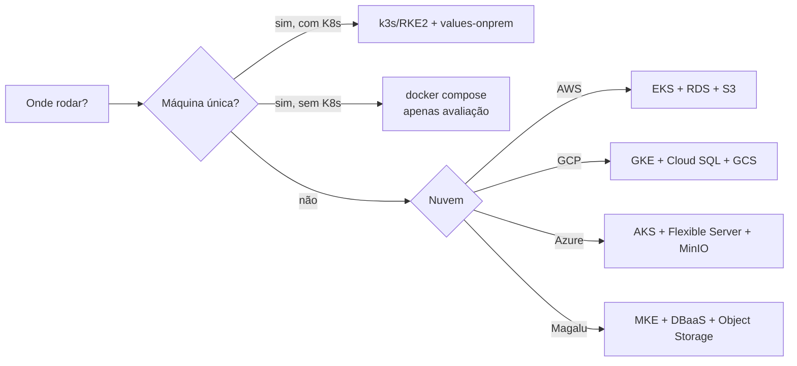

# Deploy

Este diretório reúne tudo que envolve colocar o OpenOju em execução fora do
ambiente de desenvolvimento.

```text
deploy/
  helm/openoju/          chart Kubernetes (agnóstico de nuvem)
  terraform/
    modules/             blocos reutilizáveis por nuvem
    stacks/              composição executável por nuvem
  onprem/                bootstrap de k3s e valores de referência
  keycloak/              realm de exemplo para SSO local
  environments/          gerado pelo wizard (gitignored)
scripts/provision.py     wizard interativo
```

## Compose é apenas desenvolvimento

`docker-compose.yml` na raiz serve para rodar a ferramenta localmente (banco
externo opcional, rede `proxy` do host, `/dev/dri`). Ele **não** é o caminho de
produção. Em produção use Kubernetes.

## Escolha do alvo



| Alvo | Terraform | Chart preset | Banco | Objeto | Observação |
|---|---|---|---|---|---|
| Local (kind/k3d) | — | `values-minimal.yaml` | embutido | embutido | validação e demo |
| On-premise | — (cloud-init) | `values-onprem.yaml` | embutido | embutido | VAAPI disponível |
| AWS | `stacks/aws` | `values-aws.yaml` | RDS | S3 + IRSA | ALB + ACM |
| GCP | `stacks/gcp` | `values-gcp.yaml` | Cloud SQL | GCS interop | GCLB |
| Azure | `stacks/azure` | `values-azure.yaml` | Flexible Server | MinIO | Blob não é S3 |
| Magalu | `stacks/magalu` | `values-magalu.yaml` | DBaaS | Object Storage | experimental, sem RWX |

## Fluxo com o wizard

```bash
python3 scripts/provision.py init  --env prod   # perguntas e geração
python3 scripts/provision.py doctor --env prod  # ferramentas e credenciais
python3 scripts/provision.py plan   --env prod  # terraform plan + helm template
python3 scripts/provision.py apply  --env prod  # apply + Secret + helm upgrade
```

O ambiente gerado fica em `deploy/environments/<env>/`:

```text
answers.yaml       respostas, sem segredos (pode versionar)
values.yaml        valores do Helm
terraform.tfvars   variáveis do stack
secrets.env        segredos gerados, permissão 600 (nunca versionar)
render.yaml        manifesto renderizado pelo plan (auditoria)
state.json         alvo, versões e hash dos values
runbook.md         sequência, DNS, checklist pós-apply
```

## Documentação por alvo

- [Provisionamento local](provisioning/local.md)
- [Kubernetes on-premise](provisioning/k8s-onprem.md)
- [AWS](provisioning/aws.md)
- [GCP](provisioning/gcp.md)
- [Azure](provisioning/azure.md)
- [Magalu Cloud](provisioning/magalu.md)
- [Wizard](provisioning/wizard.md)
- [Verificação pendente](provisioning/verification.md)
